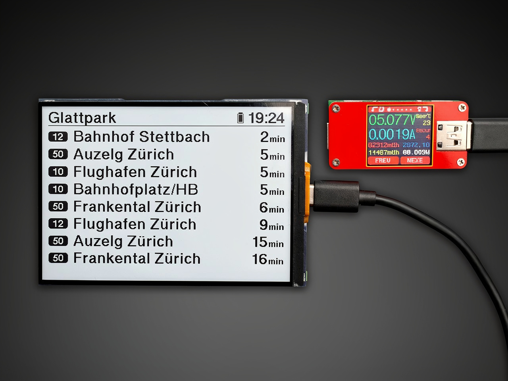
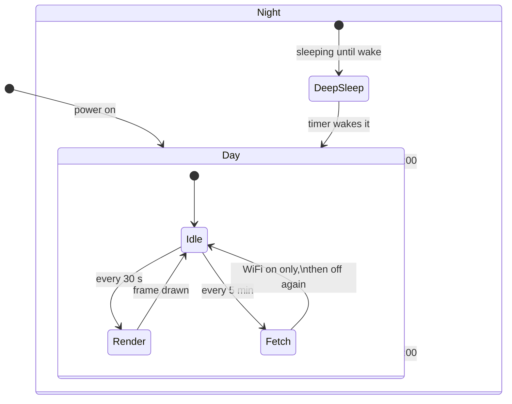

# Departures Display

A departure board for public transport on the off-the-shelf Waveshare
**ESP32-S3-RLCD-4.2**. It shows live departures for a station of your choice on a reflective
LCD that needs no backlight, and runs a few weeks on one battery charge.



## Quick start

1. **Get the board.** Works as shipped; no soldering required.
2. **Set up WiFi** - copy the template and fill in your network:
   ```bash
   cp main/secrets.h.example main/secrets.h
   ```
3. **Pick your station** in `main/main.cpp`:
   ```c
   const char *API_URL = "http://transport.opendata.ch/v1/stationboard";
   const char *STATION_NAME = "Your Station";
   ```
4. **Build and flash** (ESP-IDF, target `esp32s3`):
   ```bash
   idf.py set-target esp32s3
   idf.py -p /dev/ttyUSB0 flash monitor
   ```

That's it - the display fetches departures automatically and keeps its own clock, including
daylight saving. No timezone setting needed.

## What you see

- Up to 20 departures, refreshed every 5 minutes.
- Each row: line badge, destination, and minutes until departure (`now` when it is about to
  leave).
- Header: station name, current time, battery level.

## Power

A single charge lasts a few weeks. The display sleeps whenever it can and wakes only to
refresh.



Daytime it runs at the lowest speed that keeps up and takes a light nap between refreshes.
At night (19:00-07:00 by default) it powers the screen down and deep-sleeps in one-hour
chunks, re-reading the time on each wake.

Want a different night window? Edit `RLCD_NIGHT_SLEEP_START_HOUR` / `_END_HOUR` (and set
`RLCD_NIGHT_SLEEP_ENABLED` to `1`) in `main/user_config.h`.

